# UK Price Paid Data Warehouse

A data warehouse for the UK [Price Paid Data](https://www.gov.uk/government/statistical-data-sets/price-paid-data-downloads) on property sales. It is a MySQL star schema with location and time dimensions, populated through Pentaho Data Integration transformations, then analysed with an OLAP cube, MDX queries and reports.

**Group 39**: Tiago Deane and Afonso Matos.

> Pentaho files (`.ktr`, `.prpt`, schema XML) don't render nicely in the browser, so this README walks through the project using the screenshots in each `taskN/` folder. The original presentation is [slides_39.pdf](slides_39.pdf).

## Contents

- [Overview](#overview)
- [Technologies](#technologies)
- [Repository structure](#repository-structure)
- [Data warehouse design](#data-warehouse-design)
- [Walkthrough](#walkthrough)
- [Data attribution](#data-attribution)

## Overview

The pipeline has five stages:

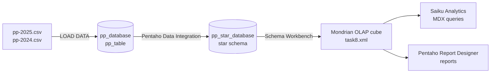

1. **Staging:** the raw yearly CSV from HM Land Registry is loaded into a flat MySQL table (`pp_table`).
2. **Warehouse:** three PDI transformations fill a star schema (`dim_location`, `dim_time`, `fact_transaction`).
3. **Cube:** a Mondrian schema (`Transactions` cube) describes the dimensions, hierarchies and the `Total_price` measure.
4. **Analysis:** the cube is explored in Saiku Analytics with MDX, including calculated members for year-on-year comparison.
5. **Reporting:** a Pentaho Report Designer report (`Sales by county`) reads the cube through an MDX query.

## Technologies

| Tool | Role in the project |
|---|---|
| **MySQL** | Staging database and star-schema data warehouse |
| **Pentaho Data Integration** (Spoon) | ETL transformations that populate the dimensions and the fact table |
| **Pentaho DataCleaner** | Data profiling and quality checking (not required by any of the numbered tasks) |
| **Pentaho Schema Workbench** | Designing the Mondrian OLAP cube definition (`task8.xml`) |
| **Saiku Analytics** | Interactive OLAP analysis and MDX queries in the Pentaho User Console |
| **Pentaho Report Designer** | Building the report on top of the cube |

## Repository structure

| Folder | Task | Contents |
|---|---|---|
| [task2](task2/) | Create and load the staging database | `task2.sql` |
| [task3](task3/) | First query on the raw data | `task3.sql`, results screenshot |
| [task4](task4/) | Create the star schema | `task4.sql` |
| [task5](task5/) | Location dimension | `task5.ktr`, step screenshots |
| [task6](task6/) | Time dimension | `task6.ktr`, step screenshots |
| [task7](task7/) | Fact table | `task7.ktr`, step screenshots |
| [task8](task8/) | OLAP cube | `task8.xml` (Mondrian schema), screenshots |
| [task9](task9/) | Saiku analysis | `task9.xlsx`, screenshot |
| [task10](task10/) | Report | `task10.prpt`, `task10.pdf`, screenshots |
| [task11](task11/) | 2024 data and bottlenecks | `task11.sql`, `bottlenecks.txt`, screenshots |
| [task12](task12/) | Year-on-year MDX query | `task12.xlsx`, screenshots |

Task numbers follow the course assignment ([project_assignment.pdf](project_assignment.pdf)). Task 1 is just downloading the 2025 CSV, which is why there is no `task1` folder.

## Data warehouse design

The source data has one row per property sale (price, date, property type, tenure, and the full address). The warehouse reduces it to a single measure, the sale price, along two dimensions: where the property is and when it was sold.

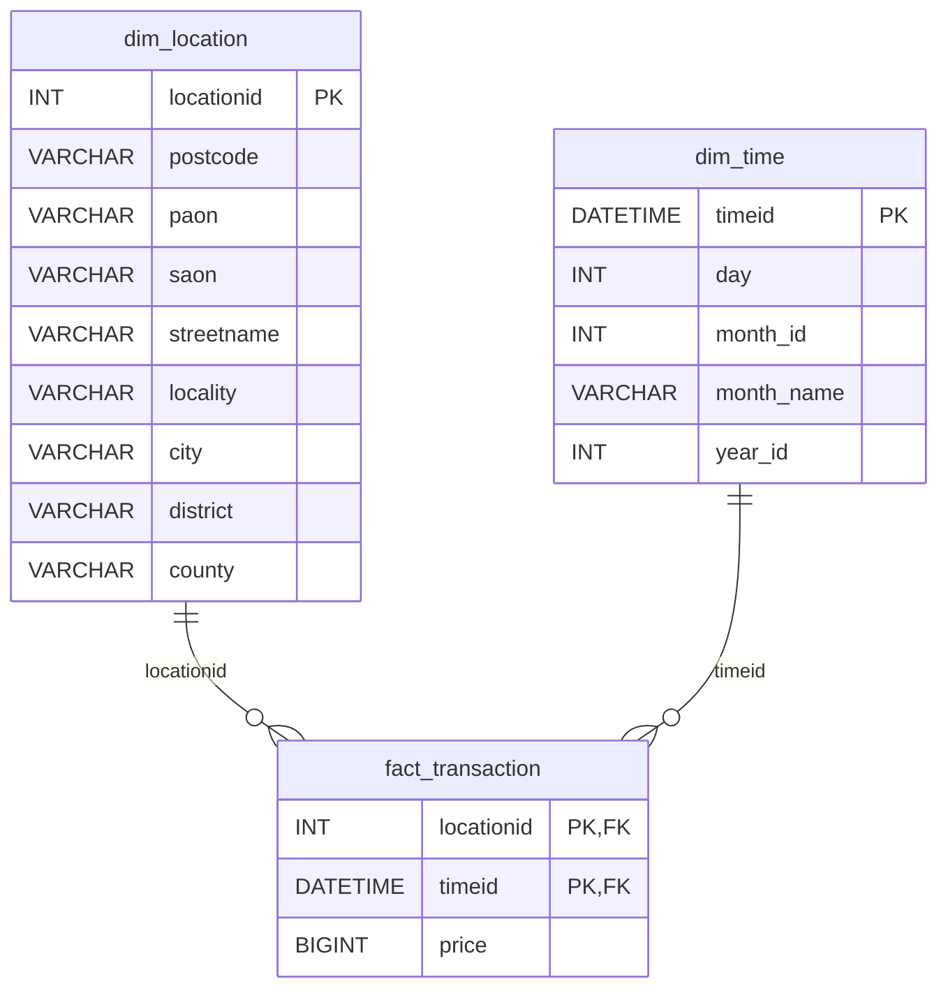

- **Grain of the fact table:** one row per property location per transfer date, holding the total price. Two sales of the same property on the same day are summed into a single row.
- **`dim_location`:** each `locationid` identifies one specific property. The course assignment only required location down to city level, but the team chose a finer grain so that each fact represents a single property's sales. County, district and city alone aren't enough for that, so the dimension also includes locality, street, postcode, PAON (primary addressable object name) and SAON (secondary addressable object name). The cube still lets you aggregate up to county.
- **`dim_time`:** keyed on the full transfer date, with day, month number, month name and year.

The DDL is in [task2/task2.sql](task2/task2.sql) (staging) and [task4/task4.sql](task4/task4.sql) (warehouse).

## Walkthrough

Each section below corresponds to a folder in this repository. Every folder also contains screenshots of the individual step configurations and data previews.

### Staging database and first query (tasks 2–3)

[task2/task2.sql](task2/task2.sql) creates `pp_database.pp_table`, with the same 16 columns as the CSV file, and bulk-loads the data with `LOAD DATA LOCAL INFILE`.

[task3/task3.sql](task3/task3.sql) is a first sanity check against the raw table: the 20 city/day combinations with the highest total sales. In the 2025 data they are all in London.

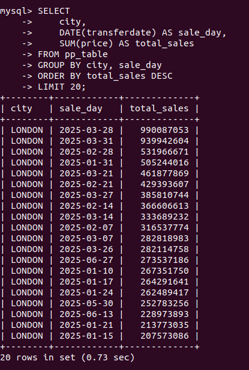

### Location dimension (task 5)

[task5/task5.ktr](task5/task5.ktr) · [screenshots](task5/)

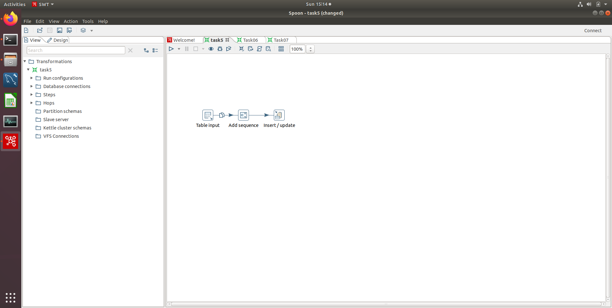

1. **Table input** reads the distinct combinations of postcode, PAON, SAON, street, locality, city, district and county from `pp_table`.
2. **Add sequence** generates the surrogate key `locationid`.
3. **Insert / update** writes the rows into `dim_location`.

### Time dimension (task 6)

[task6/task6.ktr](task6/task6.ktr) · [screenshots](task6/)

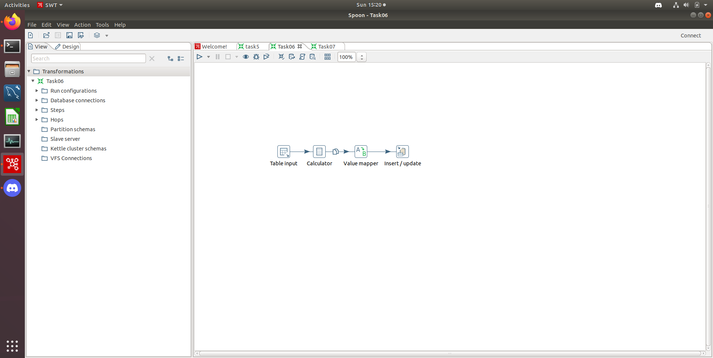

1. **Table input** reads the distinct `transferdate` values.
2. **Calculator** derives the day of the month, month number and year.
3. **Value mapper** converts the month number to its name.
4. **Insert / update** writes the rows into `dim_time`.

### Fact table (task 7)

[task7/task7.ktr](task7/task7.ktr) · [screenshots](task7/)

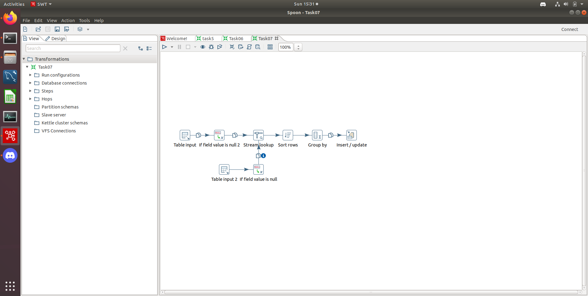

1. Two **Table input** steps read the sales from `pp_table` and the locations from `dim_location`.
2. Two **If field value is null** steps turn the NULLs that MySQL stored for empty address fields back into empty strings, so the two streams can be compared.
3. **Stream lookup** matches each sale to its `locationid` on all eight address columns.
4. **Sort rows** orders by `locationid` and `transferdate`.
5. **Group by** sums the price per `locationid` and `transferdate`.
6. **Insert / update** writes the result into `fact_transaction`.

### OLAP cube (task 8)

[task8/task8.xml](task8/task8.xml) · [screenshots](task8/)

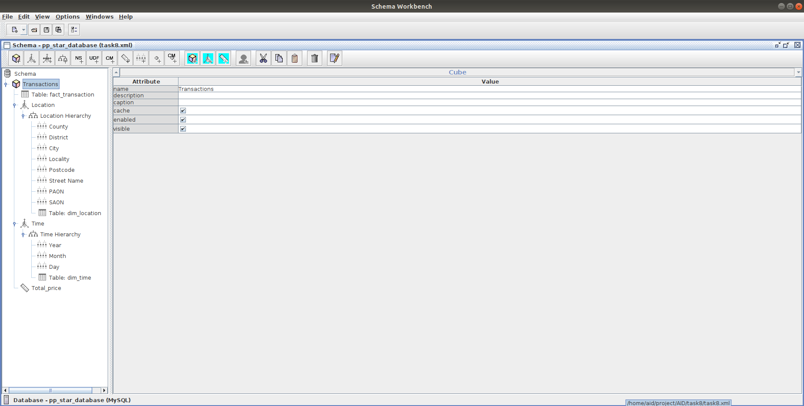

The `Transactions` cube sits on `fact_transaction` and has:

- **Location** dimension, with the hierarchy County → District → City → Locality → Postcode → Street Name → PAON → SAON.
- **Time** dimension, with the hierarchy Year → Month → Day (months are ordered by `month_id`, so they sort chronologically).
- **`Total_price`** measure, the sum of `price`.

### Analysis in Saiku (task 9)

[task9/task9.xlsx](task9/task9.xlsx) is the exported result.

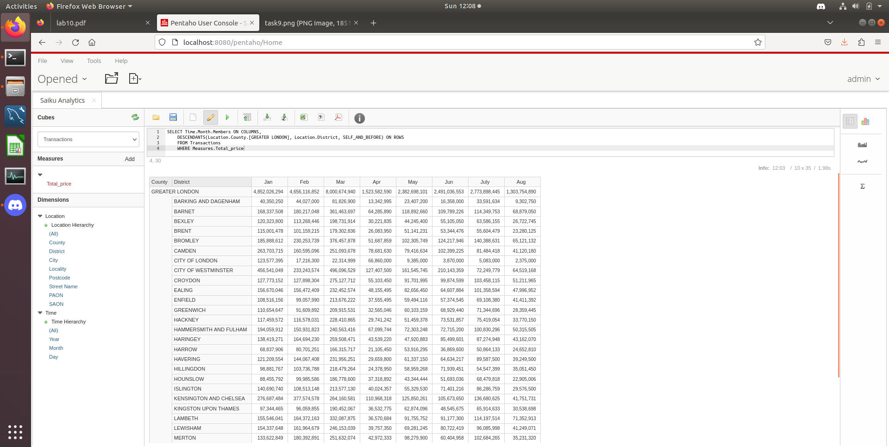

An MDX query in Saiku shows total sales per month for Greater London and each of its districts:

```mdx
SELECT Time.Month.Members ON COLUMNS,
    DESCENDANTS(Location.County.[GREATER LONDON], Location.District, SELF_AND_BEFORE) ON ROWS
    FROM Transactions
    WHERE Measures.Total_price
```

### Report (task 10)

[task10/task10.prpt](task10/task10.prpt) · [task10/task10.pdf](task10/task10.pdf)

A *Sales by county* report in Pentaho Report Designer, fed by an MDX query against the cube that returns the counties with more than £1 billion in sales, highest first. At this point only the 2025 data was loaded, so the totals are for 2025:

```mdx
SELECT Measures.Total_price ON COLUMNS,
    ORDER(
        FILTER(Location.County.Members, Measures.Total_price > 1000000000),
        Measures.Total_price, DESC
    ) ON ROWS
FROM Transactions
```

| Design mode | Preview mode |
|---|---|
| 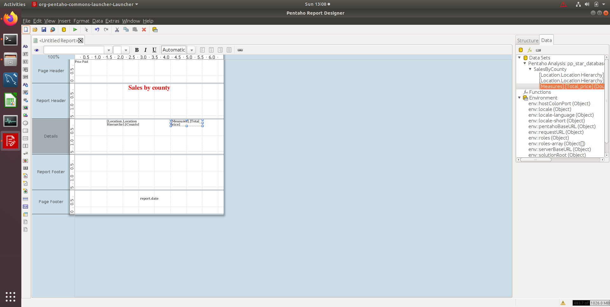 | 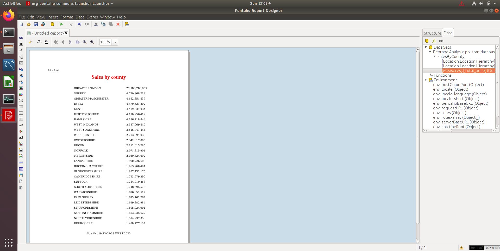 |

### Loading more data and finding bottlenecks (task 11)

[task11/task11.sql](task11/task11.sql) · [task11/bottlenecks.txt](task11/bottlenecks.txt)

The 2024 file was loaded into `pp_table` and the transformations were run again, taking the staging table to about 1.2 million sales. Watching the step metrics in Spoon showed where each transformation spends its time:

- **Task 5 (location dimension):** the bottleneck is **Table input**. It selects eight columns with `DISTINCT`, and all eight are needed so that each `locationid` identifies one specific property.
- **Task 6 (time dimension):** **no bottleneck**. All steps finish at about the same time, because the `DISTINCT` is over a single column and yields fewer than a thousand rows.
- **Task 7 (fact table):** the bottleneck is **Sort rows**. It's a blocking step: it must read every input row before passing any to Group by. In the run below it took about 39 minutes, while the two table inputs took under two minutes.

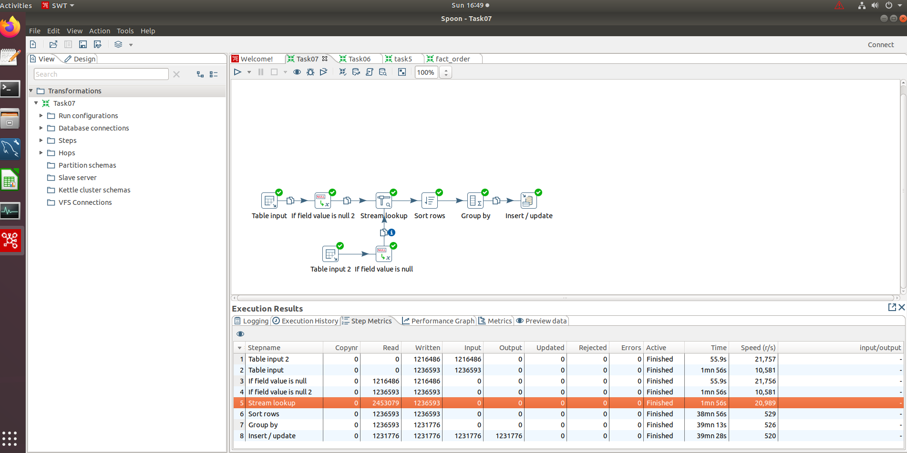

### Year-on-year comparison (task 12)

[task12/task12.xlsx](task12/task12.xlsx) is the exported result.

With both years loaded, an MDX query with calculated members compares January 2024 and January 2025 sales for each London district:

```mdx
WITH
MEMBER Measures.[Jan 2024 Sales] AS
    (Time.Year.&[2024].FirstChild, Measures.Total_price)
MEMBER Measures.[Jan 2025 Sales] AS
    (Time.Year.&[2025].FirstChild, Measures.Total_price)
MEMBER Measures.[Sales Difference] AS
    Measures.[Jan 2025 Sales] - Measures.[Jan 2024 Sales]
MEMBER Measures.[Percentage Difference] AS
    (Measures.[Sales Difference] / Measures.[Jan 2024 Sales]),
    FORMAT_STRING = '0.00%'

SELECT
{
    Measures.[Jan 2024 Sales],
    Measures.[Jan 2025 Sales],
    Measures.[Percentage Difference]
} ON COLUMNS,
    Location.County.[GREATER LONDON].Children ON ROWS
FROM Transactions
```

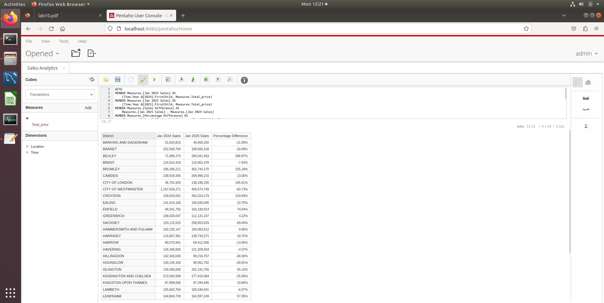

## Data attribution

Contains HM Land Registry data © Crown copyright and database right 2025. This data is licensed under the [Open Government Licence v3.0](https://www.nationalarchives.gov.uk/doc/open-government-licence/version/3/). The data itself is not included in this repository.
